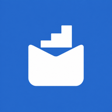
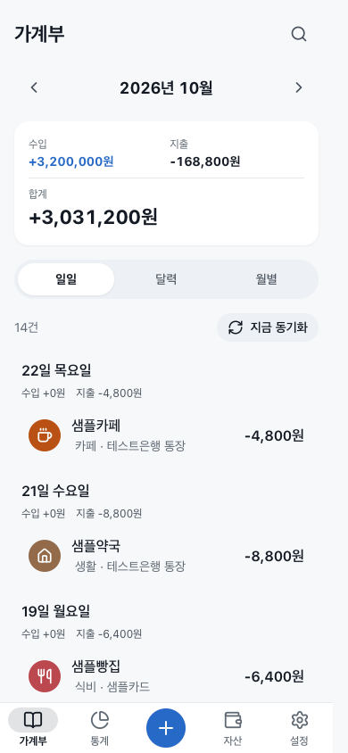
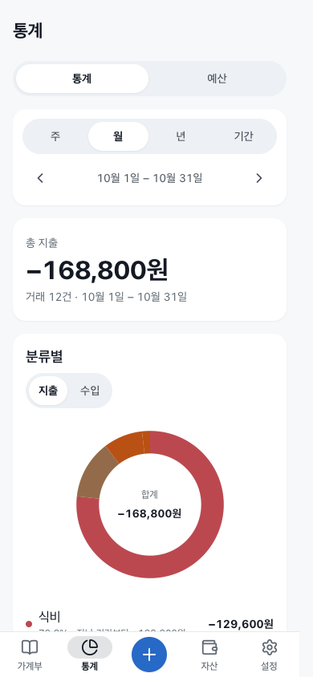
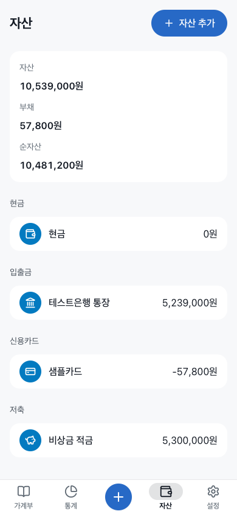
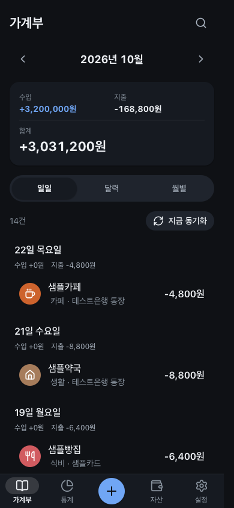
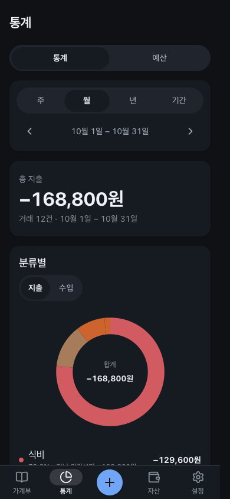
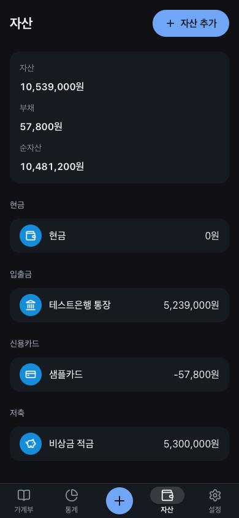

<p align="center"></p>

# ledger-app

[English](README.md) | 한국어

혼자 쓰는 가계부 PWA예요. 데이터는 내 Mac의 SQLite에 두고, 같은 Tailscale 네트워크의 폰·태블릿에서 홈 화면 앱처럼 써요.

## 좋은 점

- **데이터가 내 Mac에만 있어요.** 클라우드 데이터베이스나 외부 계정이 없고, 서버는 루프백에만 열려요. 밖에서는 내 tailnet으로만 들어와요.
- **잔액이 맞아요.** 내 계좌 사이 이체는 지출로 세지 않고, 잔액 기준일 이전 거래는 시작 잔액에 이미 들어간 것으로 보고 다시 더하지 않아요.
- **빠르게 적어요.** 키패드 입력, 즐겨찾기 템플릿, 반복 거래가 있고, 연결이 끊겨도 기록은 대기열에 남았다가 다시 연결되면 반영돼요.
- **은행 내역을 안전하게 합쳐요.** 읽기 전용 모듈에서 내역을 가져오고, 중복은 빼고, 내가 고친 분류·메모는 덮어쓰지 않아요.
- **영어·한국어를 시스템 언어에 맞춰 보여 줘요.** 밝은·어두운 테마와 폰·태블릿·데스크톱 레이아웃을 지원해요.

## 주요 기능

- 수입·지출·이체, 환불, 분류·메모·태그, 검색·기간 필터와 달력
- 은행에서 가져온 수입·지출을 거래 편집 화면의 "이체로 바꾸기"로 다른 자산(예: 맡긴 돈)과의 이체로 한 번에 바꾸기
- 월별 통계와 분류별 예산
- 계좌·현금·저축·기타 자산, 신용카드 결제 예정액과 체크카드 연결 계좌
- 자산별 시작 잔액과 선택 기준일: 기준일 이전 거래는 시작 잔액에 포함된 것으로 계산
- 반복 거래, 즐겨찾기 입력 템플릿
- CSV/XLSX 가져오기 미리보기·확정과 내보내기, JSON 백업·복원
- 연결이 끊겨도 기록·수정·삭제를 보관하는 오프라인 대기열
- 별도 읽기 전용 모듈을 통한 카카오뱅크 내역 반영, 중복 제거와 수동 수정 보존

## 화면

위는 밝은 테마, 아래는 어두운 테마예요. 계좌, 거래처, 금액은 모두 합성 데이터예요.

| 가계부 | 통계 | 자산 |
| --- | --- | --- |
|  |  |  |
|  |  |  |

## 요구 사항

- [Bun](https://bun.sh) 1.4.2 이상. 앱을 실행하는 데는 이것만 있으면 돼요(macOS, Linux, Windows WSL).
- 선택: `ops/`의 상시 실행 설치와 폰 접속에는 macOS와 [Tailscale](https://tailscale.com)이 필요해요.
- 선택: `bun run test:responsive`에는 Chrome 또는 Chromium이 필요해요.

## 빠른 시작

서버는 Bun + Hono + SQLite, 화면은 React + Vite예요.

```sh
git clone <이 저장소의 URL>
cd ledger-app
bun install --frozen-lockfile
bun run build
bun run start
```

`http://127.0.0.1:4340`에서 열어요. 처음 실행하면 `data/credentials.json`이 권한 `0600`으로 만들어져요. 파일을 비공개로 열어 `owner_token`을 로그인 화면에 입력하세요. 토큰을 터미널·로그·채팅에 출력하거나 파일을 공유하지 마세요.

설정 예제는 [`.env.example`](.env.example)에 있어요. Bun은 `.env`를 읽어요. 은행 내역 자동 수집은 선택 기능이고 기본은 꺼져 있어요. `LEDGER_MODULE`이 없으면 수동 기록·파일 가져오기·백업만으로 동작하고 아무것도 폴링하지 않아요.

개발할 때는 두 터미널에서 실행해요.

```sh
bun run start      # API: 127.0.0.1:4340
bun run dev        # Vite: 127.0.0.1:4341, /api를 서버로 전달
```

## 데이터와 접근 범위

주 데이터는 Mac의 SQLite에 저장해요. 이 앱은 별도 클라우드 데이터베이스를 사용하지 않아요. 오프라인 동작을 위해 접속한 브라우저에도 캐시와 변경 대기열이 남으므로 개인 기기에서 사용하세요.

- 수동 실행: `LEDGER_DATA_DIR`의 `ledger.sqlite`, 자격 증명, 백업
- Mac 운영 설치: `~/Library/Application Support/ledger-app/data`
- 운영 설치 시 저장소의 `data`는 운영 디렉터리를 가리키는 링크예요. 설치기는 기존 데이터나 다른 링크를 덮어쓰지 않아요.
- `data/`, `.env`, 운영 로그, 백업과 실제 거래 화면은 Git에 넣지 않아요.

서버는 루프백 주소에만 바인딩해요. 원격 접속은 Tailscale Serve의 `https:4340`을 사용하며 인터넷 공개용 Funnel은 쓰지 않아요. 쿠키 세션과 변경 요청의 Origin·CSRF 검사가 있어요. 여러 사용자의 데이터를 분리하는 서비스는 아니에요.

## 은행 내역 연결

은행 로그인·SMS 수신·엑셀 수집 프로그램은 포함하지 않아요. 이미 보유한 내역을 반환하는 신뢰할 수 있는 로컬 모듈을 `LEDGER_MODULE`로 지정해요. 앱은 `entries()`를 호출해 읽을 뿐, 원본 내역을 수정하지 않아요.

모듈은 동기 또는 비동기 `entries()`를 내보내며, 다음처럼 레코드 배열을 반환해요. 아래 예시는 합성 데이터예요.

```ts
export function entries() {
  return [{
    id: 1,
    at: "2026-03-15T12:00:00+09:00",
    account: "테스트계좌",
    kind: "출금",
    amount: -4500,
    counterparty: "샘플카페",
    balance: 995500,
    currency: "KRW",
    source: "sms",
  }];
}
```

정확한 형식은 [`server/importer/source.ts`](server/importer/source.ts)를 참고하세요. 가져온 거래의 수동 수정 필드는 잠겨서 다음 수집이 덮어쓰지 않아요. 같은 수신인에게 보냈다는 이유만으로 모두 같은 용도로 분류하지는 않아요.

## 환경 변수

| 이름 | 기본값 | 설명 |
| --- | --- | --- |
| `LEDGER_HOST` | `127.0.0.1` | `127.0.0.1`, `localhost`, `::1`만 허용 |
| `LEDGER_PORT` | `4340` | 서버 포트 |
| `LEDGER_DATA_DIR` | `./data` | SQLite·자격 증명·백업 위치 |
| `LEDGER_STATIC_DIR` | `./dist` | 빌드된 화면 위치 |
| `LEDGER_TAILSCALE_HOST` | 없음 | Serve의 `호스트:포트` |
| `LEDGER_TAILSCALE_LOGIN` | 없음 | 자동 인증을 허용할 본인 Tailscale 로그인 |
| `LEDGER_ALLOWED_ORIGINS` | 없음 | 추가 허용 Origin, 쉼표로 구분 |
| `LEDGER_MODULE` | 없음(수집 꺼짐) | 읽기 전용 수집 모듈 경로. [은행 내역 연결](#은행-내역-연결) 참고 |
| `LEDGER_WATCH_DIR` | 없음(주기 수집만) | 원본 변경 감시 디렉터리. 바뀌면 곧바로 가져와요 |
| `LEDGER_IMPORT_INTERVAL_MS` | `60000` | 자동 수집 주기(ms) |

## 문제 해결

- **서버가 `Invalid option: expected one of "127.0.0.1"|"localhost"|"::1"`을 출력하고 끝나요.** `LEDGER_HOST`가 다른 주소로 설정돼 있어요. 서버는 루프백에만 바인딩해요. 다른 기기에서 쓰려면 아래 Tailscale Serve를 쓰세요.
- **서버가 `Failed to start server. Is port 4340 in use?`(`EADDRINUSE`)를 출력하고 끝나요.** 다른 프로세스가 `LEDGER_PORT`(기본 `4340`)를 쓰고 있어요. 그 프로세스를 멈추거나 `LEDGER_PORT=4350 bun run start`처럼 다른 포트로 시작하세요.
- **`http://127.0.0.1:4340`이 JSON 본문과 함께 `404`를 돌려줘요.** 클라이언트를 빌드하지 않았거나 `LEDGER_STATIC_DIR`이 다른 곳을 가리켜요. `bun run build` 후 저장소 루트에서 서버를 시작하세요. 클라이언트가 없어도 `/api/v1/health`는 응답해요.
- **로그인 화면이 토큰을 받아 주지 않아요.** `LEDGER_DATA_DIR` 안 `credentials.json`의 `owner_token` 값을 따옴표나 공백 없이 그대로 복사하세요. 데이터 디렉터리마다 토큰이 따로 있어서, `LEDGER_DATA_DIR`이 다르면 토큰도 달라요.
- **데이터 화면에 은행 내역이 연결되지 않았다고 나와요.** `LEDGER_MODULE`을 지정하지 않으면 원래 그래요. 직접 입력, 파일 가져오기, 백업은 그대로 돼요.
- **오프라인에서 바꾼 내용이 다른 기기에 안 보여요.** 대기 중인 변경은 서버에 다시 연결될 때까지 그 변경을 만든 브라우저에만 있어요. 그 기기가 온라인이 되면 앱을 한 번 여세요.

## Mac에서 상시 실행

`ops/`는 macOS LaunchAgent와 Tailscale Serve용 운영 도구예요. Bun과 Tailscale이 필요해요. 은행 내역 수집을 켜려면 `ops/install.sh` 전에 `LEDGER_MODULE`(필요하면 `LEDGER_WATCH_DIR`도)을 지정하세요. 지정하지 않으면 수집이 꺼진 채로 설치돼요. 이후 도구를 다시 실행할 때 변수를 주지 않으면 기존 설치의 값을 그대로 써요. 작업 제한용 `heavy` 명령이 설치돼 있으면 빌드를 그걸로 감싸고, 없으면 바로 빌드해요.

```sh
bash ops/install.sh --dry-run  # 계획·충돌 확인, 실제 설치 검증은 아님
bash ops/install.sh
bash ops/update.sh
```

런타임은 `~/Library/Application Support/ledger-app`에 두고, 자기 LaunchAgent `local.ledger-app`과 자기 Serve 포트만 관리해요. 설치기가 마지막에 보여 주는 주소를 같은 tailnet의 iPhone Safari에서 연 뒤 **공유 → 홈 화면에 추가**로 설치해요. iPad도 같아요.

업데이트 전에 DB와 자격 증명을 비공개로 백업하세요. `ops/update.sh --rollback`은 코드만 되돌려요. DB 스키마가 바뀌었다면 이전 코드와 그에 맞는 데이터 백업을 함께 복원해야 해요. 자세한 설치·백업·복원·제거 절차는 [런타임 문서](docs/runtime.md)에 있어요.

## 검증과 개발 문서

```sh
bun test
bunx tsc --noEmit
bunx biome check .
bun run build
bun run test:responsive
```

반응형 검증은 Chrome/Chromium과 Bun.WebView를 사용해 합성 DB에서 320·375·390px의 화면·편집 시트·키패드·가로 넘침을 검사하고 자기 리소스를 정리해요. iOS의 날짜·시간 입력 폭은 Chrome에서 재현되지 않아서, Xcode iPhone 시뮬레이터가 있는 Mac에서는 `bun run test:responsive:ios`로 시뮬레이터 Safari의 편집 시트 날짜·시간 칸을 320·375·390px에서 따로 검사해요. 실제 iPhone의 설치 상태바와 네이티브 공유 시트는 데스크톱 검증과 별도로 확인해야 해요.

- [API 계약](docs/API.md)
- [런타임·복원](docs/runtime.md)
- [디자인 규칙](DESIGN.md)
- [개발 작업 규칙](AGENTS.md)
- [기여 안내](CONTRIBUTING.md)(영어)

## 한계

- 개인용 원화 가계부예요. 금융기관 원장, 다중 통화 회계나 세무 신고 도구가 아니에요.
- Mac이 꺼져 있거나 네트워크가 끊기면 새 동기화를 할 수 없어요. 오프라인 변경은 다시 연결된 뒤 반영해요.
- 분류·중복 판단은 보조 기능이에요. 원본 보고 잔액과 앱의 계산 잔액은 별개라 시작 잔액과 이체 목적을 확인해야 해요.
- 기준일은 한국 시간의 하루 시작이에요. 해당 날짜 이전 거래만 시작 잔액에 포함된 것으로 간주해요.
- 현재 패키지는 `0.0.1`이며 별도의 릴리스 안정성 보장을 뜻하지 않아요.

## 라이선스

[MIT License](LICENSE). 의존성은 각 패키지의 라이선스를 따라요.
