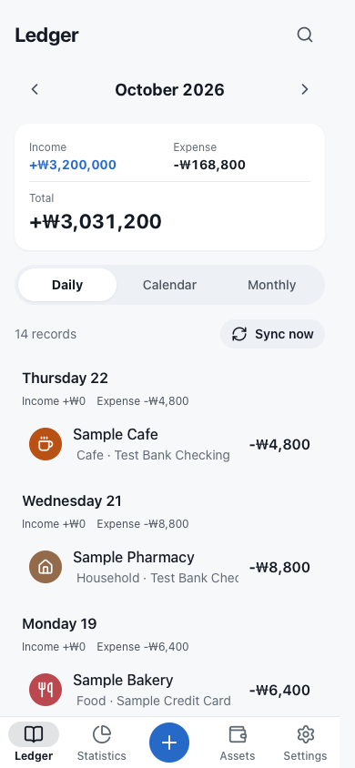
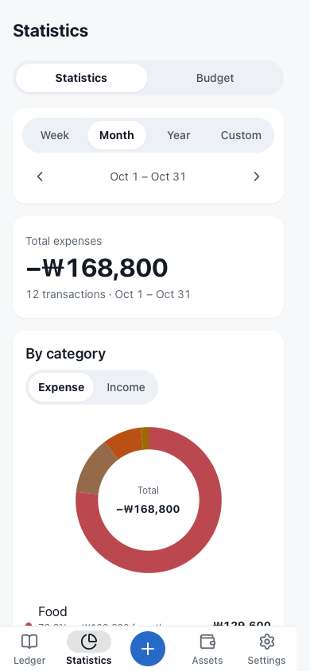
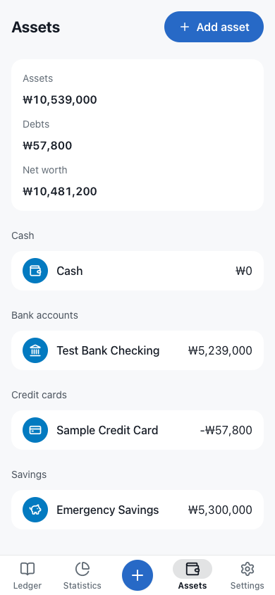
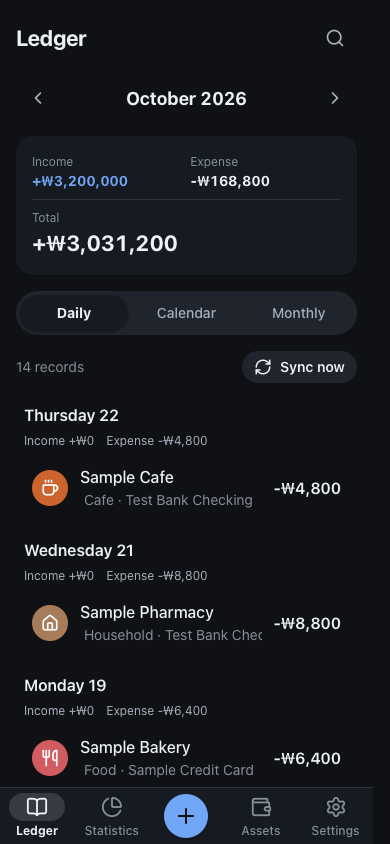
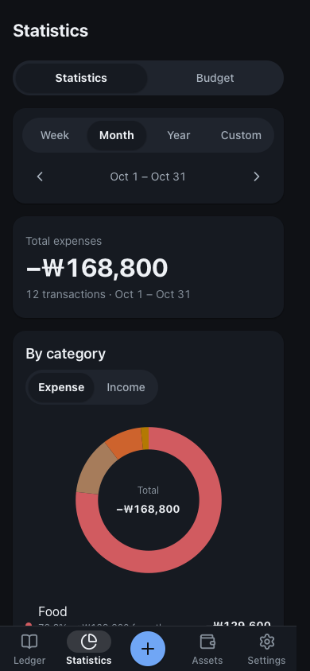
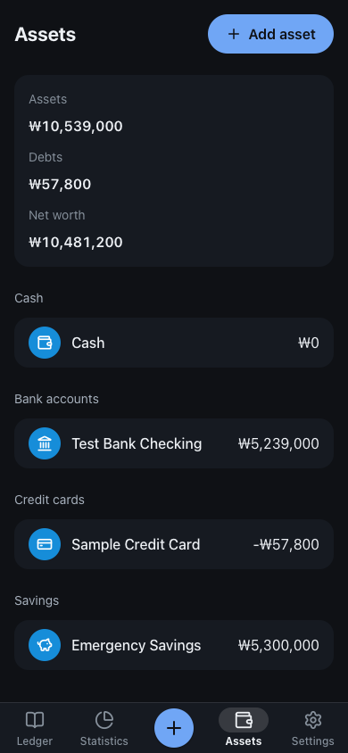

<p align="center"></p>

# ledger-app

English | [한국어](README-ko.md)

A personal finance ledger PWA for one owner. Your data lives in SQLite on your own Mac, and your phone and tablet on the same Tailscale network use it like a home-screen app.

## Why it's good

- **Your data stays on your Mac.** There's no cloud database and no third-party account. The server listens on loopback only, and outside access is limited to your own tailnet.
- **Balances add up.** Transfers between your own accounts don't count as spending. Transactions before an asset's balance date count as already included in its opening balance, so they aren't added again.
- **Recording is quick.** You get keypad entry, favorite templates, and recurring transactions. When the connection drops, changes wait in a queue and sync after you reconnect.
- **Bank history merges safely.** Records come from a read-only module, duplicates are dropped, and your own category and memo edits are never overwritten.
- **English or Korean follows your system language.** Light and dark themes are included, with layouts for phone, tablet, and desktop.

## Main features

- Income, expenses, transfers, refunds, categories, memos, tags, search, period filters, and a calendar
- **Convert to transfer** in the entry editor, which turns an imported income or expense row into a transfer with another asset (for example, money held for someone)
- Monthly statistics and per-category budgets
- Bank, cash, savings, and other assets, upcoming credit card payments, and debit cards linked to their account
- A per-asset opening balance with an optional balance date: earlier transactions count as already included in it
- Recurring transactions and favorite entry templates
- CSV/XLSX import with preview and confirm, export, and JSON backup and restore
- An offline queue that keeps creates, edits, and deletes while disconnected
- KakaoBank history ingestion through a separate read-only module, with duplicate removal and preservation of manual edits

## Screenshots

Light theme on top, dark theme below. All accounts, merchants, and amounts are synthetic.

| Ledger | Statistics | Assets |
| --- | --- | --- |
|  |  |  |
|  |  |  |

## Requirements

- [Bun](https://bun.sh) 1.4.2 or later. That is all you need to run the app on macOS, Linux, or Windows (WSL).
- Optional: macOS and [Tailscale](https://tailscale.com) for the always-on install in `ops/` and phone access.
- Optional: Chrome or Chromium for `bun run test:responsive`.

## Quick start

The server is Bun + Hono + SQLite and the client is React + Vite.

```sh
git clone <this repository's URL>
cd ledger-app
bun install --frozen-lockfile
bun run build
bun run start
```

Open `http://127.0.0.1:4340`. On first run, `data/credentials.json` is created with mode `0600`. Open it privately and enter its `owner_token` on the sign-in screen. Never print the token to a terminal, log, or chat, and never share the file.

See [`.env.example`](.env.example) for configuration; Bun reads `.env`. Bank history ingestion is optional and off by default: without `LEDGER_MODULE` the app runs with manual entry, file import, and backups, and nothing is polled.

For development, run these in two terminals:

```sh
bun run start      # API: 127.0.0.1:4340
bun run dev        # Vite: 127.0.0.1:4341, proxies /api to the server
```

## Data and access

The primary data is stored in SQLite on your Mac, and the app uses no cloud database. For offline use, each browser you sign in from also keeps a cache and a pending-change queue, so use it on your own devices.

- Manual run: `ledger.sqlite`, credentials, and backups in `LEDGER_DATA_DIR`
- Installed on a Mac: `~/Library/Application Support/ledger-app/data`
- When installed, the repository's `data` is a link to that runtime directory. The installer never overwrites existing data or a different link.
- `data/`, `.env`, runtime logs, backups, and screenshots of real transactions stay out of Git.

The server binds to loopback addresses only. Remote access goes through Tailscale Serve on `https:4340`; the public Funnel isn't used. Sessions use cookies, and changing requests are checked for Origin and a CSRF token. The app doesn't separate data for multiple users.

## Bank history

Bank sign-in, SMS capture, and spreadsheet scraping are not included. Point `LEDGER_MODULE` at a trusted local module that returns history you already have. The app only calls `entries()` and never changes the source records.

The module exports a sync or async `entries()` that returns an array of records like the one below (synthetic data):

```ts
export function entries() {
  return [{
    id: 1,
    at: "2026-03-15T12:00:00+09:00",
    account: "테스트계좌",
    kind: "출금",
    amount: -4500,
    counterparty: "샘플카페",
    balance: 995500,
    currency: "KRW",
    source: "sms",
  }];
}
```

The exact shape is in [`server/importer/source.ts`](server/importer/source.ts). The `kind` values are the Korean labels that bank exports use. Fields you edit by hand on an imported transaction are locked, so the next import won't overwrite them. Payments to the same recipient aren't all classified as the same purpose just because the recipient matches.

## Environment variables

| Name | Default | Description |
| --- | --- | --- |
| `LEDGER_HOST` | `127.0.0.1` | Only `127.0.0.1`, `localhost`, or `::1` |
| `LEDGER_PORT` | `4340` | Server port |
| `LEDGER_DATA_DIR` | `./data` | SQLite, credentials, and backups |
| `LEDGER_STATIC_DIR` | `./dist` | Built client |
| `LEDGER_TAILSCALE_HOST` | none | Serve `host:port` |
| `LEDGER_TAILSCALE_LOGIN` | none | Your own Tailscale login allowed to sign in automatically |
| `LEDGER_ALLOWED_ORIGINS` | none | Extra allowed origins, comma-separated |
| `LEDGER_MODULE` | none (ingestion off) | Path to a read-only ingestion module; see [Bank history](#bank-history) |
| `LEDGER_WATCH_DIR` | none (poll only) | Directory watched for source changes, so imports run soon after a change |
| `LEDGER_IMPORT_INTERVAL_MS` | `60000` | Automatic import interval in ms |

## Running it all the time on a Mac

`ops/` holds the macOS LaunchAgent and Tailscale Serve tooling. It needs Bun and Tailscale. To turn on bank history ingestion, set `LEDGER_MODULE` (and optionally `LEDGER_WATCH_DIR`) before `ops/install.sh`; without them the app is installed with ingestion off. Later runs of the tools keep the values of the existing install unless you set the variables again. When the `heavy` job-limit command is installed, builds run through it; otherwise they run directly.

```sh
bash ops/install.sh --dry-run  # plan and conflict check only, not a real install test
bash ops/install.sh
bash ops/update.sh
```

The runtime lives in `~/Library/Application Support/ledger-app`, and the tools manage only their own LaunchAgent `local.ledger-app` and their own Serve port. Open the address the installer prints in iPhone Safari on the same tailnet, then choose **Share → Add to Home Screen**. iPad works the same way.

Back up the database and credentials privately before updating. `ops/update.sh --rollback` restores code only; if the database schema changed, restore the previous code together with a matching data backup. Install, backup, restore, and removal steps are in the [runtime guide](docs/runtime.md) (Korean).

## Checks and developer docs

```sh
bun test
bunx tsc --noEmit
bunx biome check .
bun run build
bun run test:responsive
```

The responsive check uses Chrome/Chromium and Bun.WebView on a synthetic database to check screens, the entry sheet, the keypad, and horizontal overflow at 320, 375, and 390px, then cleans up after itself. Chrome doesn't reproduce iOS date and time field widths, so on a Mac with the Xcode iPhone Simulator, `bun run test:responsive:ios` checks those fields in Simulator Safari at the same widths. The installed status bar and native share sheet on a real iPhone still need a separate check.

Developer docs are in Korean:

- [API contract](docs/API.md)
- [Runtime and restore](docs/runtime.md)
- [Design rules](DESIGN.md)
- [Agent working rules](AGENTS.md)

## Limits

- This is a personal ledger in Korean won (KRW). It isn't a bank ledger, a multi-currency accounting tool, or a tax filing tool.
- While the Mac is off or the network is down, nothing new can sync. Offline changes apply after you reconnect.
- Categorization and duplicate detection are aids. The balance a bank reports and the balance the app calculates are separate, so check opening balances and transfer purposes.
- A balance date starts at midnight Korea time. Only transactions before that date count as included in the opening balance.
- The package is at `0.0.1`, which promises no release stability.

## License

[MIT License](LICENSE). Dependencies follow their own licenses.
